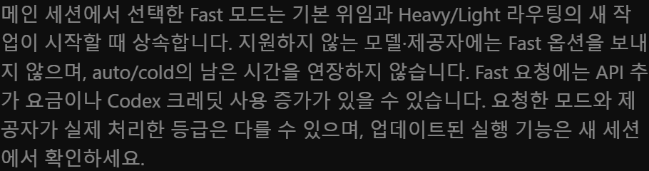

# Hermes Model Router

Profile-scoped model management and **Hermes-native subagent routing**, with a native Desktop settings page. New work uses `delegate_task`; the plugin no longer starts a separate routed worker. This is an independent NewMetaW plugin, not a Hermes core fork or a NousResearch bundled plugin.

## Native delegation migration (local candidate)

Requires **Hermes >=0.22.5**. Two namespaced DelegationProvider backends reuse core spawning, concurrency, progress, cancellation and result delivery:

| Saved `delegation.backend` | Per-task selector | Route |
|---|---|---|
| `default` | none | Existing Hermes delegation settings |
| `model-router` | required `purpose` | Existing operator-assigned Heavy/Light roles |
| `model-router-profiles` | allowlisted `profile` or configured default | Target profile identity and execution policy |

Select and explicitly save the backend in **Settings → Plugins → 모델 및 라우팅 → 작업 분담과 예비 모델**. Registration, installation, refresh, presets and existing Heavy/Light saves do **not** select a backend or grant access to other profiles. This dedicated card has its own explicit save-target selection, initially the loaded profile only, and is not silently included in the other cards' combined save. Explicit subsets/empty selections survive source changes and refresh; new profiles are never automatically included. Each selected profile keeps its own frozen settings digest. Hidden per-target permission/fallback blocks are preserved rather than copied from the source. Existing sessions keep pinned tools until a supported rebuild boundary; compression may also rebuild them. The saved setting alone does not prove current-session activation. No forced reload or shared restart is performed.

For purpose routes:

```json
{"tasks":[{"goal":"Review the exact candidate","context":"Read-only review; requirements and test evidence…","purpose":"independent-review"}]}
```

`implementation`, `mechanical`, `preliminary-review` select Light; `plan`, `semantic-final`, `independent-review` select Heavy. The existing canonical role declarations, follow-main/follow-delegation choices, explicit opt-outs and three total-runtime settings remain in place. Role totals are enforced through the native child watchdog, not a process kill. A normally omitted `total_timeout_seconds` task override is in seconds; queue time is excluded, zero disables only that task's plugin total, and progress/fallback do not reset the deadline. Unsupported or ambiguous routed-budget binding refuses rather than silently launching without enforcement. Review purpose and context are not a read-only filesystem sandbox.

For profile routes:

```json
{"tasks":[{"goal":"Collect the relevant evidence","context":"Bounded handoff…","profile":"exact-allowlisted-profile"}]}
```

The allowlist starts empty. Adding a profile/default is an explicit grant to use its model, credentials, fallback chain, reasoning, skills, SOUL and terminal policy. New profiles are never automatically included. A child keeps the parent's toolset ceiling and transcript storage; it does not attach to an existing target conversation and is not an OS security boundary. An omitted profile with no configured default follows the native parent route, not `delegation.model`. Profile routing is not automatically a Heavy review. Only one backend is active per session; these namespaces coexist with Advanced Delegation without replacing `model_map` or `profile_routes`.

**Fallback is not automatically migrated.** Legacy routed fallback starts a fresh task under a restricted exhaustion trigger; native fallback continues the same child conversation. New per-role continuation lists default OFF and require a new explicit exact-chain save/cost permission. Old rerun consent is never reused. Profile routes use the target profile's own chain. Native `result.route` is runtime-reported identity, not proof of every API response or a semantic GO.

**Legacy jobs:** `coding_route` remains for effective-role `config`, historical `status`, and existing owner-bound `join`. All public new process-start entry points return `start_retired` and spawn nothing. Existing artifacts, workers and joins are not rewritten, adopted, retried, or converted into native handles. Historical worker dependencies remain only so already-started work and evidence remain usable. The launcher oracle under `tests/` is a fake-boundary historical regression fixture, not a production launcher. The older process-routing descriptions below are historical compatibility notes, not instructions for starting new work.

See [native architecture and safety contract](docs/wiki/native-delegation.md).

[한국어 안내](#한국어-안내) · [Installation](INSTALL.md) · [Security and disclosures](SECURITY.md) · [MIT license](LICENSE)

## Install

Install the unified Python/Desktop package into each existing profile where you want to use it:

```text
hermes --profile default plugins install metamindedu/hermes-model-router
```

The public repository does not require GitHub login. Provider authentication remains with Hermes; this package does not include accounts, keys, profile configuration, conversations or job records. Review the install scanner and dependency prompts. Hermes install trust, dependency consent and Python/Desktop activation remain required. Once enabled, an installed profile without a saved routing choice defaults ON. Existing saved OFF choices and explicit skill opt-outs remain OFF; uninstalled profiles are not enabled. Installation does not change models, authorize paid fallback, rewrite budgets or launch jobs.

For reproducibility, use a reviewed full commit SHA with `--ref <40-character-SHA>`. Catalog installation by name is available **only after** the owner-submitted entry is reviewed and merged by a Hermes maintainer; a public repository or an open PR is not a catalog listing.

## Features

- Manage main, delegation, compression and title models across explicitly selected installed profiles.
- Configure separate conversation, routed-job and native-delegation fallback scopes; preserve untouched scopes.
- Choose Heavy and Light routes independently of routing-enabled profile membership. Use Heavy for planning and independent semantic review; Light for bounded implementation and mechanical work.
- Set independent native-child, Light and Heavy total-runtime budgets. The UI uses minutes; APIs and persistence use seconds. Native inactivity timeouts are a different policy.
- Inherit the **actual parent session's Fast selection** into new native and routed children on supported first-party OpenAI API/Codex paths. Preserve the original bounded expiry; strip inherited paid fields on unsupported/fallback routes.
- Track routed work in the existing Background rail with bounded, sanitized activity and native cancellation/completion handling. Verified route identity is not a semantic GO verdict.
- Apply settings through explicit scoped saves, revision/CAS checks, one-shot plans and exact readback. Ambiguous writes are not automatically repeated.

## First use



Enable the package's Desktop half and open **Settings → Plugins → 모델 및 라우팅** (Models and routing). Load a profile, review actual provider/model availability, select routing-enabled profiles and save only your intended scope. Model/fallback/copy target selections are independent; an initially checked target list does not itself authorize writes. Start a new session for updated Python tools. Existing model presets are editable examples, not live availability recommendations.

## Historical process joins (read-only compatibility)

Keep the parent productive while routed work runs: start with `completion_mode: "join"`, perform independent work, then call `coding_route` with `action: "join"` and the returned `job_id` only when its result is needed. Start remains asynchronous. Join-mode adoption is silent; it does not inject a new turn or promise a wake after the parent has ended.

The optional positive `wait_timeout` is a limit for one join call, separate from the job's configured total runtime. A join call uses a bounded local wait derived from native configured limits and can return `join_status: "pending"`; the core executor can cancel earlier, and no unconditional deadline guarantee is made for arbitrary upstream middleware delays. Explicitly rejoin if the result is still needed. Stop/steer returns `interrupted` without automatically rejoining. `joined` proves read-only collection of the route report after native exit, not native acknowledgement, model identity or semantic acceptance; missing runner artifacts remain unverified. Inspect the normal route evidence and answer. Join never calls native wait/log/poll or marks native completion consumed/observed. Use normal native sequential-barrier tool dispatch, not a custom concurrent executor; independently started routed jobs still run in parallel. Native terminal metadata is rechecked after artifact reads and remains a point-in-time snapshot, not a promise against future host corrections. Exact profile/home/parent/key/owner and native process incarnation must match. Existing notify-mode/legacy jobs cannot be converted; omitted `completion_mode` preserves the previous start behavior. No new settings, injection permission or core changes are required. Updated Python tool schemas may require a fresh session; installation alone does not update an existing session's tools.

## Security and cost disclosures

This plugin reads installed Hermes profile configuration and its own model-routing/job data. Explicit saves invoke the supported Hermes config CLI and may update selected profiles. Enabled routed jobs launch background Hermes processes with normal tools, configured providers and MCP integrations; prompts, results and job evidence are stored under that profile's plugin data. Treat those artifacts as private. The manual historical source-repair script can modify exact validated session rows only when explicitly applied.

It uses Hermes's **own** provider/authentication layer, not another vendor CLI's token store. Normal Hermes-owned OAuth refresh may occur. It has no separate credential store, telemetry endpoint, self-updater or automatic approval bypass. Provider/MCP network access is inherited from the user's Hermes setup. Read [SECURITY.md](SECURITY.md) before enabling routing or multi-profile settings writes.

Fast and fallback requests can increase API charges or subscription-credit usage. A requested tier does not prove the provider's processing tier or billing. A native "primary restored" notice means the request path was restored, not that a successful model response was observed. Core retry/backoff remains core-owned.

## Compatibility and current limitations

### v0.4.9 plugin-owned policy without standalone copies

Routing initialization and settings saves no longer create or read
`skills/adaptive-coding-orchestration/SKILL.md` in any profile. Use the bundled
`model-router:adaptive-coding-orchestration` policy. The package-owned `compat`
entry remains available for explicitly configured legacy-name discovery; it is
not copied into profiles. Existing user-owned local skill files are neither
removed nor overwritten. Removing a duplicate is a separate, explicit cleanup.

Missing standalone files no longer create a repair-only save. Configuration and
effective-settings CAS checks, scoped saves, one-shot plans and readback remain.
A pending pre-upgrade plan containing skill snapshots is consumed and refused
before writes; reload settings and generate a fresh plan. Installation does not
rewrite model, fallback, timeout or routing preferences. Existing Python tool
callbacks may require a new session; no shared-process restart is required.

### v0.4.8 profile preparation and activation-aware readiness

The app-level Desktop UI remains a **single installation**. The native Python package and activation are still **per profile**; there is no global registration or automatic installation into future profiles.

- Expand **Profile plugin preparation** in the settings page. Each discovered profile is shown as missing, installed-but-disabled, code/configuration ready, or unsupported/manual review. This is a local observation, **not proof that an existing conversation has registered tools or completed a model call**. Saved routing OFF remains OFF even when Python is active.
- **Refresh preparation status only** discovers newly created profiles without copying settings, widening model/routing/timeout/fallback target selections, or replacing unsaved settings drafts. Installing requires an explicit target selection and separate consent. After preparation changes, settings saves stay locked until an explicit full reload; full reload discards unsaved edits.
- Automatic preparation is limited to **at most 32 missing profiles per batch**, a uniquely resolved local native connection, safe known declarations (PyYAML only; no extra capabilities, environment requirements or Node package), and an exact match between the source install record and the current official catalog repository/commit. It uses the native Plugins Hub admission with fixed `model-router`, a full commit ref, `force: false` and `enable: true`. No shell commands, arbitrary repositories or custom install endpoint are accepted.
- Existing, disabled, partial, modified/differing-version or unverified installations are **not automatically overwritten or re-enabled**. Use the native Plugins manager or the displayed validated per-profile CLI command and review scanner, dependency and capability prompts. Older SDKs, missing provenance, unavailable policies and remote contexts fall back to manual guidance. If the Python backend itself is inactive, the page shows a separate native activation/install guide.
- Preparation does not copy model roles, fallback choices, limits or saved routing opt-outs. A fresh installation without a saved choice keeps the existing disclosed default **routing ON**. New sessions may be required for previously deferred tools; native activation is not a forced rebuild of every existing conversation.
- Queued work stops on cancel or source-scope change; an already-dispatched native install is **not cancelled or rolled back**. The host binds operations by profile name, not an atomic profile-incarnation token: do not rename/delete profiles or edit package trees during preparation.
- Every attempted target is read back. A timeout/disconnect or unverifiable receipt is **unknown**, never automatically retried. A plugin-local persisted safety latch survives page remount/reload; manual reconciliation must occur in the original scope. Releasing that latch does not assert native completion, and uncertain targets remain excluded from further automatic preparation.

### v0.4.7 cold-host binding, local completion and quiet Windows launches

Normal base-Python hosts can load the native PM environment module before its optional adoption helper. The router now validates exactly one already imported generation under the verified native install root without importing that helper, switching generations or relaxing child interpreter checks. The default local launch context's explicitly empty profile name is matched narrowly to the default plugin scope; missing or foreign context remains rejected.

Validated default-local routed jobs now request native completion notifications even when no UI-session ID is bound. Existing parent/lane ownership, Stop/busy and explicit notification opt-out remain host-owned. A completion is a wake to read the exact job result, not a successful review verdict. The parent should consume its owned native process result through terminal `process_manage wait` before returning idle; a partial/head log read is not acknowledgement, and raw re-delivery before result consumption is not an exactly-once guarantee. Additional automatic continuation may use the configured model's quota; installation does not start jobs or change model/fallback/budget choices.

Noninteractive Windows worker, legacy runner and settings-CLI launches explicitly suppress console windows, without changing POSIX session handling. Native-process test fixtures also suppress their consoles. Source/runtime, native child binding, registration and live review success are verified separately; skipped platform/permission tests are not counted as passes. No core files are modified.

### v0.4.6 hosted-runtime compatibility

Settings and effective-config inspection use Hermes's native YAML policy when available, with a legacy PyYAML fallback only when the native adapter itself is absent. A broken native dependency is not hidden by fallback. Routed children accept only source roots bound to Python's active venv: a managed `environments/<id>/venv` and its sibling workspace, or a conventional source-owned `.venv`/`venv`. Missing, incomplete, linked or unknown bindings fail closed; arbitrary `sys.path`/`find_spec` candidates are not trusted. The verified source precedes a job's working directory, and bootstrap file/spec origins must match it. The Desktop completion regression honors the native consumer's accepted-turn boolean, preserving busy/Stop requeue and exactly-once wake checks. Native PluginManager registration of `coding_route` and its policy skill is checked with PyYAML imports explicitly blocked in a fresh credential-free runtime, separately from the install Doctor's conditional probe. Existing-session registration is not assumed from files alone.

### v0.4.5 first-save fix and default-on routing

First settings saves preserve the raw `skills.disabled` CAS baseline, including omitted/null/legacy forms, rather than comparing a normalized empty list with missing storage. New installed profiles without saved choices default ON without a settings migration. Existing explicit OFF choices remain OFF, and opt-out controls move under advanced routing settings. Heavy/Light may use the same provider/model/effort in separate jobs; role-specific verification and budgets remain distinct. Same-model review is not different-model review diversity. Models, fallback consent, native approvals and stored budgets are not changed on installation.

### v0.4.4 direct-Main default

Main implements small, bounded changes and their focused checks directly, without calling `coding_route`. Ordinary implementation delegation must justify at least two substantive independent workstreams with a clear net parallel benefit after startup/context/coordination costs; do not manufacture a second task from tests, builds or optional review. The same threshold applies to native delegation. Explicit user delegation and required Heavy/independent review remain exceptions; high-risk judgment, production approvals, profile opt-in, models, fallback consent and runtime settings are unchanged. This is guidance, not a new runtime rejection or a two-child minimum on the API. Existing Python tool descriptions may require a new session.

### v0.4.3 settings placement

The existing settings page now belongs under **Settings → Plugins**, using the public `registerSettingsPage` API (or its documented `settings.plugins` contribution). The main-sidebar row is removed; the command-palette shortcut opens the native settings entry. The old `/model-router` route remains only for existing bookmarks. This is a navigation-only change: the existing page, profile scope, draft/save/CAS protections, routing/model/fallback/Fast/runtime policies and activation choices are unchanged. Older hosts that cannot display plugin settings need a supported Hermes Desktop build; no private-core patch or new sidebar fallback is added.

### v0.4.2 startup compatibility fix

Hermes builds that retired the bundled Tirith scanner no longer provide `tools.tirith_security`. Earlier Model Router versions still imported it unconditionally, so routed children could fail during startup before a model request or tool execution. Version 0.4.2 skips only that exact missing optional module. On older hosts the original initializer still runs; missing parent packages, other dependencies and initializer errors still stop startup. This is a plugin-only compatibility fix, not an approval/security bypass or a change to Fast inheritance, models, fallback consent or runtime limits. Catalog users receive it only after the new exact-SHA pin is maintainer-reviewed and merged.

- The Desktop UI is currently **Korean-first**; the package overview and policy skill include English guidance.
- Runtime/SDK regression and Desktop validation were performed on Windows. Linux/macOS installation/runtime support has not been fully exercised; the catalog entry must disclose that scope.
- Requires a Hermes build supporting unified Python/Desktop packages and the request/tool middleware used here. Features whose supported native hooks are unavailable do not gain an alternate private-core patch.
- Fast inheritance does not cover transports that bypass the observed request middleware, including `codex_app_server`. Native/routed children keep their creation-time policy; later parent toggles are not retroactive.
- Python tools in existing sessions may remain deferred until a new session. Mid-run activation is not a forced replacement of every existing tool callback.
- Install scanning can report CAUTION for fixed subprocess execution and the manual repair script. Admission/installation must inspect those warnings; the plugin does not disable the scanner.

## Development

### First-time setup (0.6.0)

After native installation/enablement, open **Settings → Plugins → 모델 및 라우팅 → 처음 사용하는 프로필 준비**. Eligible current profiles start selected. The user must explicitly run setup; viewing, refreshing, registration and future-profile discovery never install or save settings. Existing explicit OFF, saved backend choices (including `default`), managed/unsafe state and dormant paid continuation remain protected.

Setup reuses native exact-profile admission/install/enable operations, then a one-shot `initial-setup-preview`/`apply` operation owning **only `delegation.backend = model-router`** for raw-absent selectors. It does not materialize optional backend blocks, copy models/credentials/fallbacks/timeouts, grant cross-profile access, or rewrite canonical settings. Other cards' drafts remain untouched and require an explicit state reload after a mutation. Newly added profiles are offered, never automatically provisioned.

Automatic installation additionally requires the catalog repository, full SHA **and version** to match the source. Until a new release's catalog update is maintainer-merged/visible, new-profile automatic installation is truthfully unavailable; a public source release alone is not catalog admission. Differing/custom existing packages require native manual review. Normal native security/dependency/capability gates are retained. See `after-install.md`.

The settings UI distinguishes primary Heavy/Light models from optional spare-model switching. Its native card saves to explicitly selected profiles, initially the loaded profile only. Normal saving remains one click; account-access confirmation applies only when permissions are expanded. Runtime settings are not changed merely by installing the UI update.

For the two Windows real-CLI fixture tests, set `HERMES_TEST_CLI` to the absolute path of a genuine installed Hermes launcher when isolating `HOME`/`LOCALAPPDATA`. This is a test-only locator; native trust checks and all temporary-home write assertions remain unchanged. Tests without a real compatible launcher are explicitly skipped.

Use an isolated test environment with the corresponding Hermes source/dependencies available. The full native integration suite is host-dependent; do not interpret a missing Hermes checkout as runtime success.

```text
node --test tests/*.mjs
hermes plugins validate . --json
hermes plugins doctor . --ci
```

Release dependencies are bounded (`PyYAML>=6,<7`). No credentials or local state should be committed. Install/update only through Hermes; catalog updates require a new reviewed SHA-pin PR. Licensed under MIT, copyright NewMetaW.

## 한국어 안내

Hermes Desktop의 **모델 및 라우팅** 페이지에서 프로필별 모델과 코딩·복잡한 비코딩 판단 작업의 Heavy/Light 경로를 관리하는 네이티브 플러그인입니다. 설정 관리와 라우팅 사용 여부는 별개입니다.

## 다른 PC에 설치

**v0.4.2 호환성 수정:** 현재 Hermes에서 제거된 `tools.tirith_security`를 이전 실행기가 필수로 불러와 라우팅 자식의 시작이 실패하던 문제를 수정했습니다. 해당 모듈의 정확한 누락만 허용하고 구버전 초기화와 다른 오류 차단은 유지합니다. Fast 상속·모델·폴백·시간 설정·승인 정책은 변경하지 않습니다. 공식 카탈로그의 버전 갱신은 별도 SHA 갱신 PR의 유지관리자 병합 후 반영됩니다.

공개 저장소 `metamindedu/hermes-model-router`에서 설치합니다. GitHub 로그인 없이 설치할 수 있으며, 새 PC의 Hermes 모델 제공자 인증은 별도로 준비합니다.

```text
hermes --profile default plugins install metamindedu/hermes-model-router
```

설치 신뢰·의존성 동의와 Python/Desktop 활성화를 확인하세요. 플러그인이 설치되고 별도 라우팅 선택을 저장하지 않은 프로필은 기본 ON입니다. 기존에 저장한 OFF와 명시적 스킬 비활성화는 보존하며, 플러그인이 없는 프로필은 켜지 않습니다. 모델·폴백·승인·시간값과 개인 프로필 설정·대화 자료는 설치만으로 변경하거나 복사하지 않습니다. 프로필별 설치, 버전 고정, 확인·업데이트 절차는 [INSTALL.md](INSTALL.md)를 참고하세요.

## 사용

1. **설정 → 플러그인 → 모델 및 라우팅**을 엽니다. 메인 사이드바의 기존 항목은 제거되며, 명령 팔레트의 바로가기는 새 설정 경로를 엽니다.
2. 기준 프로필의 설정을 불러오거나 **OpenAI / Non-OpenAI 프리셋**으로 네 모델 역할을 한 번에 채운 뒤, 필요하면 개별 값을 편집합니다. 프리셋 선택만으로 실제 설정은 바뀌지 않습니다.
3. **모델 설정 적용 대상**은 화면을 처음 열거나 연결 범위가 바뀔 때 **모든 프로필이 선택**됩니다. **전체 선택 / 전체 해제**로 일괄 조정할 수 있습니다. 사용자가 해제한 선택은 기준 프로필 변경이나 상태 새로고침으로 다시 확대하지 않습니다. 라우팅만 변경하려면 모델 적용 대상을 전체 해제하세요.
4. **라우팅 세부 설정 → 고급: 라우팅 일시 중지 및 프로필 사용 여부**에서 필요할 때만 프로필별로 끕니다. **라우팅 활성 프로필**은 이 고급 설정 안의 목록입니다. **Heavy/Light 설정 적용 대상**은 편집한 경로를 복사할 프로필 목록이며, 처음에는 전체 선택됩니다. Heavy/Light 값을 수정하거나 대상 목록을 직접 선택한 뒤 저장하면 지정한 대상에만 경로를 적용합니다. 기존 값 그대로 여러 프로필에 복사하려면 **전체 선택**을 누르고 저장하세요. 단순히 활성 프로필만 바꾸거나 일반 모델만 저장하면 기존 경로는 보존됩니다.
5. Heavy는 메인 모델, Light는 서브에이전트 모델을 따라가는 것이 기본이며 별도 지정도 가능합니다. Heavy/Light에 동일 모델을 사용해도 각 작업은 별도 컨텍스트로 실행합니다. 따라가기를 복사하면 각 대상 프로필의 모델을 사용합니다. 활성 상태·폴백·비용 허용은 Heavy/Light 복사 대상이 아닙니다. 수동 대상 선택은 불러온 프로필 변경·새로고침 후에도 유지하지만, 일회 복사 의도는 초기화됩니다.
6. 편집 중 **저장할 내용 · 실시간 참고**에서 대상과 변경 범위를 확인합니다. **모델 설정 저장**, **라우팅 설정 저장**, **시간 제한 저장** 및 각 폴백 카드의 저장 버튼은 해당 범위만 저장합니다. **전체 설정 저장**은 여러 섹션을 함께 저장할 때 사용합니다. 다른 섹션에 남아 있는 편집값은 개별 저장에 포함하지 않습니다. 별도 미리보기 버튼이나 확인 체크 단계는 없습니다. 저장 중에는 편집·중복 저장을 막고 서버에서 최신 상태 충돌을 검사합니다.

저장한 설정과 실제 프로필 설정이 다른 경우 drift로 표시합니다. 실행 중인 세션의 모델/도구는 즉시 바뀐다고 가정하지 않습니다. 변경 후 라우팅 작업은 새 세션에서 시작하세요.

## 서브 에이전트 전체 실행 시간

**모델 및 라우팅 → 전체 실행 시간 제한 (TOTAL)**에서 **일반 / Light 라우팅 / Heavy 라우팅** 시간을 각각 **분 단위**로 설정하고, **시간 제한 적용 대상**에서 복수 프로필을 선택합니다. 처음에는 편집 가능한 프로필 전체가 선택되며 **전체 선택 / 불러온 프로필만 / 전체 해제**로 조정할 수 있습니다. 모델/Heavy·Light/폴백의 대상 목록과 독립적이며, 수동으로 고른 부분·빈 목록은 프로필 변경이나 상태 새로고침으로 확대하지 않습니다.

**시간 제한 저장**은 선택한 프로필들에 세 시간값만 저장합니다. 편집값을 바꾸지 않아도 이 버튼으로 다른 대상에 복사할 수 있습니다. **전체 설정 저장**에는 시간값을 수정했거나 적용 대상 선택을 명시적으로 조정한 경우에만 포함합니다. 처음부터 전체 체크된 상태만으로 시간값을 복사하지 않습니다. 대상마다 자기 revision으로 충돌을 검사하며, 지원되지 않거나 읽기 전용인 프로필의 값은 추정하지 않습니다.

**모델 설정 저장**은 선택한 모델 대상의 네 역할만 저장하고, **라우팅 설정 저장**은 라우팅 활성 목록과 Heavy/Light 선언을 저장합니다. 모델·라우팅 개별 저장은 시간값이나 별도 폴백을 저장하지 않습니다. 저장된 폴백과 새 주 모델의 충돌 검사는 계속 수행합니다. 부분 실패·결과 불명 응답은 자동으로 재저장하지 않고 실제 상태를 확인해야 합니다.

| 옵션 | 적용 대상 | 기본값 |
|---|---|---|
| 일반 서브 에이전트 전체 실행 시간 | 네이티브 `delegate_task`로 실행한 자식 각각 | `0` — 플러그인 전체 시간 제한 없음 |
| Light 라우팅 전체 실행 시간 | 구현·기계적 작업·예비 검수 `coding_route` 작업 | `60`분 |
| Heavy 라우팅 전체 실행 시간 | 계획·의미 검수·독립 검수 `coding_route` 작업 | `60`분 |

- 세 옵션 모두 `0`은 해당 범위의 플러그인 전체 실행 시간 제한을 끕니다. Light의 `0`과 Heavy의 양수는 독립적으로 적용됩니다. 양수는 진행 중이어도 적용되는 총 경과 시간이며, 기존 고정 15분 상한은 없습니다. 요청·도구 단위 타임아웃, iteration 제한, 종료 정리 및 네이티브 보호는 그대로 유지됩니다.
- 화면은 소수 분 입력을 지원합니다. 저장·실행 API는 기존처럼 초 단위이며, 저장할 때 변환합니다. 이전 단일 라우팅 설정은 기존 값을 Light와 Heavy에 동일하게 이어받습니다. 읽기·설치만으로 설정 파일을 다시 쓰지 않으며, 실제 변경을 저장할 때 분리된 형식으로 기록합니다. 새 분리 설정을 이전 클라이언트의 단일 시간값으로 덮어쓰는 요청은 거부합니다.
- `delegation.child_timeout_seconds`는 현재 네이티브의 **무진행 시간 제한**입니다. 이 플러그인의 전체 시간 옵션들과 다른 값이며, 화면 저장이나 설치로 변경하지 않습니다.
- 일반 자식은 native가 실제 등록한 running time을 기준으로 각각 계산합니다. 큐 대기는 포함하지 않고 활동이 있다고 제한 시간이 다시 시작되지 않습니다. 초과하면 해당 대화가 소유한 정확한 자식에 native 중지를 요청합니다. 취소 요청 수락과 실제 종료는 다르며, 공유 Hermes 프로세스나 다른 대화의 자식을 강제 종료하지 않습니다.
- 라우팅 호출에서 `timeout`을 생략하면 실제 작업의 Light/Heavy 등급에 해당하는 프로필 값을 사용합니다. 명시한 `timeout`은 **초 단위**로 그 작업에만 우선하며 `0`도 가능합니다. 보통 에이전트는 별도의 짧은 값을 넣지 않습니다. 유한한 작업의 primary/fallback은 같은 역할의 전체 deadline을 공유하고, 타임아웃 때문에 작업을 자동 재실행하지 않습니다.
- 설정은 정확한 프로필의 `plugin-data/model-router/timeouts.json`에 저장합니다. 일반 모델·폴백의 공유 schema와 native YAML은 변경하지 않습니다. 저장은 기존 단일 계획의 프로필 소유권·revision·파일 CAS·만료·중복 적용 방지와 실제 readback을 따릅니다. 실행 중 작업은 시작 때 확정한 값을 유지합니다.
- 아직 전체 시간 enforcement 코드가 설치되지 않았거나 설정 파일을 안전하게 읽을 수 없는 프로필은 편집을 잠그고 기존 값을 보존합니다. Python middleware/hook가 필요한 기존 대화는 새 세션/지원되는 프로필 플러그인 reload가 필요할 수 있습니다.

## 라우팅 적용 범위

작고 범위가 명확한 수정은 메인 모델이 직접 처리합니다. 작은 버그·문구·설정·UI 수정과 관련 테스트는 Main에서 끝냅니다. 일반 구현 위임은 독립적인 실작업 두 개 이상으로 나눌 가치가 있고, 시작·문맥 전달·조정 비용보다 병렬 처리 이득이 클 때만 사용합니다. 테스트·빌드·선택적 검수로 작업 수를 부풀리거나 작은 일을 억지로 쪼개지 않습니다. 이 기준은 `coding_route`와 기본 `delegate_task`에 함께 적용합니다. 사용자의 명시적 위임 요청과 필수 Heavy·독립 검수는 예외이며, 단일 필수 검수 때문에 구현 자식까지 추가하지 않습니다. 고위험 판단·운영 승인·프로필 활성화·모델·폴백·시간 설정은 그대로 유지합니다. 작업 수를 API에서 강제하는 변경이 아니라 에이전트 판단 지침입니다.

동봉 정책은 프로필마다 동일합니다. 코딩뿐 아니라 근거가 충돌하거나 여러 근거를 종합해야 하는 판단, 내용 오류의 영향이 큰 학습자료·문항 검토, 반복된 개념적 실패가 있는 복잡한 비코딩 작업에도 Heavy 계획과 내용 검토를 적용합니다. 대량 콘텐츠는 범위를 나누고 저장된 체크포인트와 시간·재시도 예산을 두며, 확대 전 파일럿을 확인합니다. 외부 쓰기는 기존 승인 아래 직렬화합니다. 단순 글쓰기·번역·요약·정보 추출·한 단계 조회는 비코딩 작업이거나 길다는 이유만으로 Heavy에 보내지 않습니다.

공통 정책 문구의 배포는 라우팅 사용 동의가 아닙니다. 실제 도구·모델·승인 설정과 라우팅 활성 여부는 프로필별 설정을 따르며, 이 문서만으로 프로필 멤버십이나 설정을 변경하지 않습니다.

## 모델 프리셋

기존 BAT 백업에 선언되어 있던 값을 그대로 옮긴 템플릿입니다. 최신 모델 자동 추천이 아니며, 선택 후 직접 수정할 수 있습니다. 값이 템플릿과 달라지면 사용자 지정으로 표시합니다.

| 역할 | OpenAI (`openai-codex`) | Non-OpenAI |
|---|---|---|
| 기본 대화 | `gpt-6-astra-900k` · `medium` | `xiaomi` / `mimo-v2.6-pro` · `max` |
| 작업 위임 | `gpt-6-luna-900k` · `max` | `deepseek` / `deepseek-flash` · `max` |
| 대화 압축 | `gpt-6-luna-900k` · `medium` | `deepseek` / `deepseek-flash` · `medium` |
| 제목 생성 | `gpt-6-luna` · `none` | `deepseek` / `deepseek-flash` · `none` |

프리셋은 **네 모델 역할의 편집값만** 채웁니다. 모델 적용 대상, 라우팅 활성 목록, 별도로 지정한 Heavy/Light 경로와 대체 모델·비용 허용 설정은 바꾸지 않습니다. 따라서 별도 라우팅 모델을 지정해 둔 경우 고급 라우팅 설정도 확인하세요. 제공자 인증은 기존 Hermes 설정을 사용하며 프리셋에 자격 증명은 포함하지 않습니다.

## 세션 Fast 모드 상속

메인 세션에서 선택한 Fast 모드는 **기본 `delegate_task` 자식과 Heavy/Light `coding_route` 자식**이 새 작업을 시작할 때 상속합니다. 프로필 기본값을 다시 읽어 부모의 세션 선택을 덮어쓰지 않으며, 설정 화면이나 설치만으로 Fast를 켜지 않습니다.

- 상속 대상은 현재 Hermes가 지원하는 OpenAI API·Codex 구독의 모델/전송 경로입니다. 미지원 모델·제공자·외부 프록시에는 상속된 유료 Fast 옵션을 보내지 않습니다. 비-OpenAI 폴백으로 전환하면 남아 있는 Fast 옵션도 제거합니다.
- 부모의 명시적 Normal은 Normal로 이어받고, Fast/Ultrafast는 지원 여부를 해당 자식의 실제 요청 경로에서 검사합니다. Ultrafast 미지원 모델을 임의로 다른 유료 등급으로 바꾸지 않습니다.
- `auto/cold`는 부모 창의 원래 만료를 이어받습니다. 큐 대기·중첩 자식·폴백이 새 창을 열거나 남은 시간을 연장하지 않습니다. 만료 확인에 사용하는 현재 Hermes의 scalar 호환성 경계가 검증되지 않으면 유료 Fast를 연장하지 않습니다.
- 시작한 작업은 시작 시점의 선택을 유지합니다. 이후 부모에서 Fast를 켜거나 끄더라도 이미 시작한 자식의 정책을 소급해서 변경하지 않습니다. 기존 미등록 작업을 찾아서 재입양하지 않습니다.
- Fast 요청에는 API 추가 요금이나 Codex 크레딧 사용 증가가 있을 수 있습니다. 요청에 전달한 tier는 제공자가 실제 처리한 등급이나 청구 결과의 증거가 아닙니다. 응답에 별도 처리 등급이 확인돼야 구분할 수 있습니다.
- Hermes 코어·native agent 상태·전역 Fast/모델/폴백 설정은 변경하지 않습니다. Python 실행 hook/middleware가 필요한 기존 대화는 새 세션 또는 지원되는 프로필 플러그인 reload 후 적용됩니다. `codex_app_server`처럼 이 middleware/관측 경로를 통과하지 않는 전송은 이 기능의 보장 범위가 아닙니다.

## 폴백 관리

일반 모델 프리셋과 폴백 설정은 독립적입니다. 폴백은 주 모델을 사용할 수 없을 때 쓰는 예비 모델입니다. **메인 세션의 일반 대화**, **플러그인의 Heavy/Light 작업·검증 라우팅**, **Hermes 네이티브 서브 에이전트(`delegate_task`)**를 각각 나누어 설정합니다. 모델·세 폴백의 적용 대상은 화면을 처음 열 때 모든 프로필이 선택됩니다(폴백의 읽기 전용/지원되지 않는 프로필 제외). 사용자가 부분 선택하거나 전체 해제한 목록은 기준 프로필 변경이나 새로고침에서 확대하지 않습니다. 각 대상 목록은 서로 독립적입니다. 체크만으로 설정이 저장되거나 폴백이 복사되지는 않습니다. **불러온 프로필만**은 위에서 설정을 불러온 프로필 하나만 남기는 선택 단축 버튼이며, 저장·복원 버튼이 아닙니다. **라우팅 활성 프로필**은 적용 대상이 아니라 기능 사용 상태이므로 기존 활성화 설정을 그대로 표시합니다.

| 범위 | 동작 | 편집할 수 있는 항목 |
|---|---|---|
| 일반 대화 | Hermes가 현재 대화 문맥에서 제공자·모델을 전환 | 사용/중지, 제공자·모델 목록과 순서 |
| 작업·검증 라우팅 | 승인된 동일 작업 등급의 경로로 새 시도를 최대 한 번 시작 | 사용/중지, Heavy/Light별 제공자·모델·추론 강도 |
| 위임 작업 | 위임받은 자식의 Hermes 제공자 전환 | 기본 규칙/사용 안 함/위임 전용 목록과 순서 |

- **일반 대화:** `fallback_providers`와 이전 `fallback_model`을 함께 읽습니다. 중지할 때는 두 키를 모두 비워 이전 설정이 몰래 살아남지 않도록 합니다. 전환 조건·재시도는 실제 Hermes 정책을 읽기 전용으로 설명하며, 지원되지 않는 사용량 초과 전용 모드나 전체 재시도 횟수 보장은 제공하지 않습니다. 추론 강도는 기존 Hermes의 모델별 override/프로필 설정을 따릅니다. 일부 상속형 하위 작업·자동 보조 호출에도 이 체인이 영향을 줄 수 있습니다.
- **작업·검증 라우팅:** 자식 main-agent의 native fallback chain은 명시적으로 비워 일반 대화의 체인과 격리합니다. 구독 소진이라는 구조화된 오류 증거, 완전한 실행 관측·종료, 남은 시간, 해당 경로의 승인이 모두 있어야 대체 실행합니다. 도구 호출이나 부분 답변이 이미 관측됐거나 timeout/중단/증거 누락이 있으면 자동으로 처음부터 다시 실행하지 않습니다. stdout에 소진 문구가 등장한 것만으로 대체 모델을 호출하지 않습니다.
- **위임 작업:** `delegation.fallback_providers`를 별도 관리합니다. **기본 규칙**(null/미설정)은 제공자·모델·endpoint를 고정하지 않은 자식만 부모 체인을 상속합니다. 고정된 자식도 전환하려면 **위임 전용 목록**을 명시하세요. **사용 안 함**은 `[]`입니다. 작업별 모델 지정에 따라 실제 상속 여부가 달라질 수 있으며, 이 기능은 플러그인 라우팅의 새 작업 재실행과 다릅니다.
- **비용 고지:** 예비 모델은 제공자 요금제에 따라 추가 비용이 발생할 수 있습니다. 별도 동의 체크박스 대신 각 카드에서 안내합니다. 작업·검증 라우팅은 조건을 만족할 때 새 작업을 최대 한 번 시도한다는 점도 고지합니다. 사용자가 저장 버튼을 누른 정확한 대상·모델만 서버 검증 후 허용 정보와 함께 저장합니다. 설치·프리셋 선택·일반 모델만 저장하는 동작으로 폴백을 켜거나 새로운 허용 정보를 만들지 않습니다.
- **실시간 참고와 저장:** 변경 요약은 편집 중 화면에서 계산하는 참고사항이며, 편집만으로 서버 계획이나 쓰기를 실행하지 않습니다. **전체 설정 저장**은 모델·라우팅과 **수정한 폴백 및 명시적인 복사 대상**을 함께 저장합니다. 각 카드의 저장 버튼은 해당 폴백만 저장합니다. 내부 서버 검증은 유지하지만 별도 저장 전 절차로 노출하지 않습니다. 수정하지 않은 폴백은 보존하고, 수정한 폴백의 대상이 없으면 저장을 막습니다. 고급 옵션·관리자 고정 설정은 읽기 전용으로 보존합니다. 저장 응답이 끊겨 결과를 모르면 실패로 단정하거나 자동 재저장하지 않고 실제 상태 확인을 요구합니다.
- **메인 복귀 의미:** 일반 대화는 다음 턴에 Hermes가 사용 제한·쿨다운을 확인하여 기본 모델 재시도를 결정합니다. 런타임 복원 알림은 요청 경로를 복원했다는 뜻이며 정상 응답을 확인했다는 뜻은 아닙니다. 설정 화면의 예비 경로 목록도 현재 대화의 실측 모델이 아닙니다. 플러그인은 native 복귀/backoff를 재구현하거나 복귀 버튼·상시 감시를 추가하지 않습니다. 라우팅은 폴백 시도 중 기본 경로로 전환하지 않으며 다음 새 작업은 기본 경로에서 시작합니다.
- **반영 시점:** 일반 대화의 체인은 다음 턴에 다시 읽힐 수 있지만 진행 중 작업을 중단하거나 현재 모델을 즉시 원복하는 비상 정지 기능이 아닙니다. 플러그인 라우팅 작업은 시작 시 승인된 정책을 스냅샷으로 고정합니다.

설치 자체는 기존 모델·폴백 정책을 바꾸지 않습니다. schema 1은 읽을 수 있으며, 명시적으로 적용할 때 schema 2의 관리/승인 정보를 저장합니다. 자격 증명은 기존 Hermes 계층에서만 사용하고 UI·작업 증거에는 보관하지 않습니다. 원래 Hermes 인증 계층의 정상 OAuth 갱신은 별개입니다.

## 과거 프로세스 작업 표시 (읽기 전용 호환)

새 라우팅 작업은 Background에 **작업명 · Heavy/Light · 대상 모델**로 표시됩니다. 예: `서브 에이전트 작업: 게시 안전성 독립 검수 · Heavy · gpt-6-astra-900k`. 긴 작업 ID는 기본 이름 대신 상세 터미널 안내에 남깁니다. 작업을 클릭하면 용도, 요청한 모델·제공자, 프로필, 작업 폴더 이름과 ID를 확인할 수 있습니다. 상세 터미널의 모델명 뒤에는 작업 시작 시 선택된 Effort 설정을 괄호로 표시합니다(예: `gpt-6-luna-900k (max)`). 이 값은 실행에 전달한 설정이며 제공자가 내부적으로 정규화한 값이나 폴백 전환 후의 실측값을 뜻하지 않습니다. 기존 X 버튼은 실제 프로세스를 중지합니다.

이전 버전에서는 `coding_route(action="start", title="설정 UI 수정", ...)` 또는 CLI `route --title "설정 UI 수정"`으로 작업명을 지정했습니다. 현재 이 시작 경로는 종료되었으며 새 작업은 네이티브 `delegate_task`를 사용합니다. 1–96자의 **공개 표시용** 이름이므로 자격 정보·고객 자료·private 프롬프트를 넣지 마세요. 제목 없이 실행한 예전 호출도 한국어 용도 이름으로 표시됩니다. 요청 모델 표시는 관측된 실제 모델 증거가 아니며, 프로세스 종료가 검수 GO를 의미하지 않습니다. private 작업 로그와 프롬프트는 터미널 안내로 전달하지 않습니다.

Windows에서는 플러그인의 작업 실행기·에이전트 실행 단계와 timeout 정리 명령을 창 없이 실행합니다. 에이전트가 도구로 실행하는 외부 프로그램까지 모두 숨기는 기능은 아닙니다.

네이티브 서브에이전트 위임 lifecycle을 생성하거나 내부 store를 조작하지 않습니다. 별도 입력창 목록 없이 기존 Background와 클릭해서 여는 작업 상세 터미널만 사용합니다. 기존 실행 중 작업은 생성 당시 표시를 유지하며, 업데이트된 도구/정책이 필요한 기존 대화는 지원되는 플러그인 재탐색 또는 새 세션이 필요할 수 있습니다.

## 경계

- 모델 관리 UI는 설치된 프로필에서 사용할 수 있지만 작업·검증 라우팅은 선택한 프로필에서만 활성화됩니다.
- 기존 일반 `delegate_task`는 자동 교체하지 않습니다. 동봉 스킬은 복잡한 코딩·비코딩 판단 작업의 Heavy 필수 검수를 `coding_route`의 기존 명시적 목적에 따라 실행하도록 안내합니다.
- `semantic-final`, `independent-review`는 Heavy 경로입니다. Light 예비 검수로 대신하지 않습니다.
- `route_verified`는 실제 모델·제공자 증거이며 코드의 의미적 GO가 아닙니다. 최종 판정은 검수 내용과 후보를 함께 확인해야 합니다.
- 유료 대체 경로는 명시적으로 설정·허용한 경우에만 사용합니다. 임의 모델/제공자 변환을 하지 않습니다.
- API key/OAuth 정보는 기존 Hermes 인증 저장소를 그대로 사용합니다. UI나 플러그인 설정에 저장하지 않습니다.
- Hermes 코어 및 전역 delegation 설정을 작업별로 바꾸지 않습니다.

## 패키지

UI, 설정 서비스, 라우팅 작업 실행기, 동봉 스킬을 한 패키지로 배포합니다. `compat/adaptive-coding-orchestration`은 기존 bare skill 자동 탐색을 위한 작은 진입점입니다. 실제 정책은 `model-router:adaptive-coding-orchestration`에 있습니다.

초기 프로필 범위는 `docs/profile-audit.json`의 실제 스킬 탐색 결과를 보존합니다. 패키지를 신뢰·활성화한 설치 프로필에 저장된 선택이 없으면 라우팅 기본값은 ON이며, 기존 OFF·스킬 비활성화 선택은 보존합니다. 패키지가 없는 프로필은 켜지지 않습니다. Desktop UI는 앱 수준에서 공유되지만 런타임 도구와 작업 파일은 호출 프로필에 귀속됩니다.

## 작업 표시와 자식 세션

플러그인 라우팅 작업은 채팅 하단의 기존 **Background** 표시로 추적합니다. 실제 실행 프로세스를 연결하며 네이티브 서브에이전트 lifecycle을 위조하지 않습니다. 새 라우팅 자식은 `subagent`로 분류되어 일반 세션 목록에 노출되지 않습니다. 결과와 실제 모델 증거는 기존 작업 상태 조회로 확인합니다.

기존에 잘못 분류된 자식은 `scripts/repair_routed_session_sources.py --home <정확한 프로필 home>`으로 먼저 dry-run합니다. 작업 증거가 확인된 세션의 source만 백업·조건부 교정하며 대화는 삭제하지 않습니다. 상세 운영 경계는 `docs/wiki/routed-session-visibility.md`를 참고하세요.

## Background 작업 상세 활동

추가 입력창 진행 UI는 폐기했습니다. 전용 DOM 감시·조회·타이머·중지 버튼과 부모 진행 인덱스/CLI를 제거했으며, 새 패널로 대체하지 않습니다. 기존 **모델 및 라우팅** 설정 페이지는 유지합니다.

Background의 작업명은 고정된 **작업명 · Heavy/Light · 대상 모델**입니다. 작업을 클릭하면 기존 읽기 전용 터미널에서 시작 안내, `[경과 시간] 마지막으로 확인한 활동`, 프로세스 종료 확인과 고정된 소요 시간을 확인합니다. 모델 응답 대기 중에는 활동을 꾸며내거나 같은 줄을 반복하지 않습니다. 약 0.5초마다 최신 공개 활동을 관찰하므로 빠른 연속 활동은 합쳐질 수 있으며 전체 이벤트 로그가 아닙니다. 기록은 작업당 256줄/64,000자 이내로 제한하며 한도 이후에도 종료 요약은 남깁니다.

원본 로그·프롬프트·도구 인자·숨겨진 추론·응답 스트림·최종 답변 전문은 상세 출력으로 복사하지 않습니다. 정제된 완결 중간 메시지 또는 도구명만 전달하고 출력 직전 다시 정제합니다. 작업/시도·프로필·부모/runtime·실제 process 소유권이 일치해야 하며 다른 대화나 과거 작업을 스캔하여 연결하지 않습니다.

실제 ProcessRegistry가 실행/종료/중지의 권위입니다. 관찰자는 프로세스를 기다려 회수하거나 중지하지 않으며 native lifecycle/exit code를 바꾸지 않습니다. 중지와 자연 종료가 경합하면 native 종료 사유가 나중에 정정될 수 있으므로 상세 요약은 **프로세스 종료 확인과 소요 시간만** 고정하고, 종료 종류는 Background의 현재 상태를 따릅니다. 의미적 검수 GO를 추론하지 않습니다. 검수 내용과 실제 모델 증거는 기존 작업 결과로 확인합니다.

Desktop에 결속된 새 라우팅 작업은 네이티브 **프로세스 완료 알림**을 통해 정확한 부모 대화를 깨웁니다. 공개용 작업 안내와 작업 ID는 native reader가 시작되기 전에 넣어 매우 빠른 종료에도 결과 조회 대상을 보존합니다. 정상 종료 시 실행기가 먼저 작업 결과/상태를 저장하고 종료하며, 부모는 깨어난 뒤 정확한 process ID로 `process_manage(action="wait", session_id=...)`의 종료 결과를 소비하고 `coding_route(action="status", job_id=...)`로 실제 결과를 확인합니다. 실패·취소·타임아웃 알림도 성공이나 검수 GO를 뜻하지 않습니다. 원본 private 로그나 답변 전문은 완료 알림에 복사하지 않습니다.

활동이 많은 작업의 완료 알림은 native 출력의 끝부분만 포함하여 최초 작업 ID가 잘릴 수 있습니다. 그 경우 알림의 정확한 process ID로 `process_manage(action="log", session_id=..., offset=0, limit=40)`를 호출해 시작 안내의 작업 ID를 복구합니다. 앞부분 로그 조회만으로 완료를 소비했다고 보지 말고 정확한 process ID의 종료 결과를 `wait`로 확인한 뒤 해당 UUID만 상태 조회합니다. 같은 제목·다른 작업이나 인접 폴더에서 ID를 추측하지 않습니다. native 취소 이벤트는 발행 시점 snapshot이며 reader/kill 경합 뒤 최종 종료 사유가 정정될 수 있으므로, 최신 native receipt와 별도 작업 결과를 함께 확인합니다.

부모가 이미 실행 중이면 native가 완료를 보류하고, Stop을 누른 경우에는 사용자 후속 입력 전 자동 재개하지 않습니다. 명시적인 `display.background_process_notifications: off`는 그대로 존중합니다. Goal의 대기·일시정지·예산은 native 정책을 따르며 플러그인이 Goal을 재설정하지 않습니다. v0.4.7은 검증된 기본 로컬 세션에도 완료 알림을 요청하며, 다른 비-Desktop 실행과 이미 시작한 작업의 계약은 보존합니다. `status.update`는 규격에 맞는 Background 새로고침일 뿐 완료 알림이 아닙니다.

상세 활동 수집은 새 작업에만 연결합니다. 기존 작업을 재실행하거나 과거 기록을 backfill하지 않습니다. 호스트 종료·소유권 소실·관찰 시간 한도(작업 제한 시간+30초)에는 관찰이 끝나며 실제 작업 상태를 위조하지 않습니다. 종료 후 덧붙인 상세 요약은 현재 호스트의 메모리 출력입니다. native 완료 알림/보존 결과가 먼저 저장될 수 있으므로 알림 본문이나 호스트 재시작·메모리 정리 후의 보존 출력에 마지막 활동·요약이 남는다고 보장하지 않습니다. 플러그인이 native 보존 결과를 덮어쓰지 않습니다.

## 개발 및 검증

```bash
uv run --no-project --with pytest --with pyyaml --with fastapi --with httpx python -B -m pytest tests -q -p no:cacheprovider
node --test tests/test_desktop.mjs
node --test tests/*.mjs
hermes plugins doctor . --ci
```

네이티브 SDK 프로필 전송 검증은 호환되는 Hermes 소스와 해당 Desktop의 esbuild가 있을 때 `HERMES_DESKTOP_SOURCE_ROOT=<Hermes 소스 경로> node --test tests/test_native_sdk_preparation.mjs`로 실행합니다. SDK의 실제 descriptor→gateway 프로필 결합 코드를 실행하고 최종 전송 인자를 검사하며, 네트워크/OS 경계만 대체합니다. 경로를 지정하지 않은 단독 저장소 테스트에서는 이 세 사례가 명시적으로 skip됩니다. Python의 네이티브 Fast 테스트는 플러그인 생성 후 기준 홈/프로필을 바꾸지 않고 실제 프레임워크의 동일한 scope를 유지합니다.

설정 파일은 Hermes base의 `plugin-data/model-router/settings.json`입니다. 프로필 `config.yaml`은 지원되는 `hermes config set` 명령으로만 투영합니다. 미리보기 토큰은 변경 시점의 revision과 대상 설정 digest에 묶이고, 적용 전에 다시 확인합니다. 부분 실패는 부분 실패로 기록하며 다른 작업의 설정을 자동 롤백하지 않습니다.

Desktop 화면은 인증된 `cli.exec` RPC와 플러그인 등록 CLI `hermes --profile <name> model-router status|preview|fallback-preview|apply`를 사용합니다. 따라서 새 REST 경로 마운트를 위해 현재 대화를 끊고 백엔드를 재시작할 필요가 없습니다. 이 경로는 셸 문자열이 아니라 명시적 argv 배열이며, REST API와 같은 서비스를 사용합니다. 쓰기 실패 후 다른 전송 경로로 자동 재시도하지 않습니다.

CLI `cli.py status|preview|fallback-preview|apply|route|job-status`도 동일한 서비스/실행기를 사용합니다. Python에는 PyYAML이 필요하며, 활성 Hermes 환경에서 실행하거나 격리된 `uv run --no-project --with pyyaml python cli.py ...`를 사용할 수 있습니다. 호출 프로필은 `HERMES_HOME`으로 명시합니다. `initialize`는 최초 관리자가 기존 설정을 가져올 때만 사용합니다.

## 설치와 복구

`scripts/install_local.py --root <Hermes base> --routing-profiles <names...>`는 쓰기 없는 계획 출력입니다. `--apply`는 검수 완료된 패키지를 각 프로필에 복사하고 플러그인/스킬 활성화 설정만 변경합니다. 모델 설정은 변경하지 않으며 프로필별 백업과 설치 receipt를 남깁니다. 기존 설치가 있으면 명시적 업데이트 없이 덮어쓰지 않습니다.

설치 후 Desktop의 네이티브 플러그인 활성화/재검색 경로로 UI를 연결합니다. Python 도구는 다음 세션에 반영되는 경우가 있습니다. 실행 중 작업을 끊기 위해 전체 앱/게이트웨이를 재시작하지 않습니다.

기존 `hermes-set-all-models.bat`는 설정 원본에서 제외하고 같은 UI를 여는 호환 바로가기로 전환합니다. 원본 BAT와 이전 스킬은 전환 전 백업합니다. 복구 시에는 백업 당시와 현재의 변경을 비교하고, 해당 플러그인만 비활성화/제거하세요. 설정 파일 전체를 무조건 덮어쓰지 마세요.
