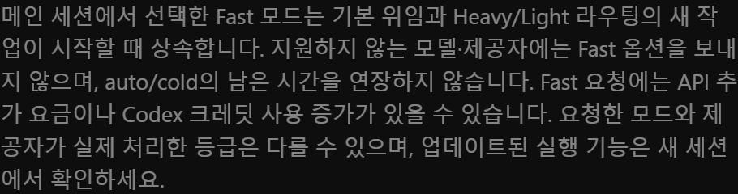

# Hermes Model Router

Model Router assigns a profile's native `delegate_task` work by task slot and exposes model settings in Hermes Desktop. A separate, opt-in `profile_task` tool attaches to Gateway-owned target sessions. This is an independent NewMetaW plugin, not a Hermes core fork or a NousResearch bundled plugin.

[한국어 안내](#한국어-안내) · [Installation](INSTALL.md) · [Security and disclosures](SECURITY.md) · [Release notes](docs/releases/v0.18.1.md) · [MIT license](LICENSE)

## Task slots and runtime limits

In **Settings → Plugins → 모델 및 라우팅**, each slot has a row for its model and its total runtime limit. A slot follows the profile's current Main model (`main`) or uses its own model (`custom`). An unset slot follows Main. Two slots can use the same model without sharing a limit.

| Slot | Purpose sent by the agent |
|---|---|
| `design` | `plan` |
| `code-complex` | `implementation` |
| `code-simple` | `mechanical` |
| `verify-simple` | `preliminary-review` |
| `verify-complex` | `semantic-final`, `independent-review` |
| `computer-use` | `computer-use` |
| `advise` | `advise`, only through `ask_advisor` |

Enter the limit in **minutes**. Leave it empty for **2 hours (7200 seconds)**; enter `0` for no plugin total limit on that slot. Ordinary and profile-routed delegation use a separate `delegate_total_seconds`, default `0` (off). Native inactivity and iteration limits still apply. `coding_route(action="config")` returns the effective `slot_timeout_seconds` map and `delegate_timeout_seconds`. Normally omit native `total_timeout_seconds`; when a particular task has an external deadline, its override is in **seconds**. See [runtime limits](docs/wiki/total-runtime-limits.md).

Operators can define up to four custom slots in **사용자지정 슬롯**. Each definition has an ID `custom:<name>` (2–32 lowercase letters, digits or hyphens after the prefix; start with a letter or digit), a label (1–24 characters) and a one-line description (1–120 characters). The ID is also the purpose. Definitions are shared across profiles; model and timeout settings are not. A new session sees the updated purpose list. The description is untrusted scope information, not instructions. Custom slots have no spare chain and do not replace a required review.

## Delegation and review

Hermes owns spawning, concurrency, progress, stop and result delivery. `coding_route` only reads configuration. Historical process jobs cannot be inspected or joined through the plugin.

| Saved `delegation.backend` | Per-task selector | Route |
|---|---|---|
| `default` | None | Ordinary Hermes delegation |
| `model-router` | `purpose` | Slot in the launching profile; reports the slot ID |
| `model-router-profiles` | Allowlisted `profile` or configured default | Target profile's identity and policy |
| `model-router-auto` | `execution` plus `purpose` or explicit `profile` | `model:<slot>` or `profile:<name>` |

For example, in automatic mode:

```json
{"tasks":[
  {"goal":"Plan the current project change","execution":"model","purpose":"plan"},
  {"goal":"Collect specialist evidence","execution":"profile","profile":"exact-allowlisted-profile"}
]}
```

A model task cannot also name a profile. A profile task cannot also name a purpose. Invalid selectors are refused without retrying on the other branch. The allowlist starts empty. Granting a target permits the use of its model, credentials, reasoning, skills, SOUL and terminal policy. The child retains its parent's toolset ceiling and transcript ownership; it does not join an existing target conversation. Installation or a change to a slot never grants this access. The session's actual tool schema, not a saved setting alone, determines which selectors are available.

Main handles small, bounded edits and their checks directly. When a slot uses Main's model, delegate for context size, long runtime or independent parallel work, not merely because a slot exists. The bundled `model-router:adaptive-coding-orchestration` policy (2.0.0) names required purposes: `plan`, `semantic-final` and `independent-review`. A preliminary review never satisfies these requirements. Final and independent reviews use a fresh child even when the model is the same. See [the direct-Main policy](docs/wiki/direct-main-default.md).

### Ask the advisor

`ask_advisor(question, context)` consults the read-only `advise` slot at a decision point and returns in the same tool call. Pass the facts or excerpts needed; the advisor does not see the parent conversation. The tool explicitly sets a 300-second per-call limit. It skips dispatch if the slot resolves to the caller's provider and model. The guard blocks tools other than reading and lookup, and the advisor child cannot be continued. `delegate_task` refuses direct requests for `advise`. Advice is not a final review or permission to act.

## Settings, fallback and cost

The model section edits the conversation, compression and title models, delegation method and slot models. The ordinary delegation model is managed in Hermes settings. Select the target profiles and review the fields that will change. Selecting a target alone does not copy unedited values or grant permission to run work there. Scoped saves use expiring plans, revision checks and readback. If a write's outcome is unknown, inspect its target rather than repeating it.

- **Ordinary conversation and delegation:** `native_fallback` and `delegation_fallback` describe the respective Hermes fallback policies. Compression and title cards use their own `auxiliary.<task>.fallback_chain`.
- **Model-routed child:** `delegation.backends.model-router` and `delegation.backends.model-router-auto` use separate schema 2 blocks. Each built-in slot has its own ordered chain and exact-chain cost consent for that profile and backend. Continuation defaults off. A permitted spare continues the same child, not a fresh copy of its task.
- **Profile-routed child:** uses the target profile's ordinary chain, not the launching profile's slot chain.
- **Fast:** supported native requests inherit the actual parent session's selection and original expiry. A later toggle does not change an existing child. Unsupported transports, including `codex_app_server`, are outside this guarantee. Fast and fallback can cost extra. A requested setting or restored route does not prove a successful provider response or billing outcome.

The shared settings store is `plugin-data/model-router/settings.json` under the default Hermes root (schema 5). Each profile's `plugin-data/model-router/timeouts.json` uses schema 3. No runtime migration is performed. Incompatible settings cause an error on the page and routing fails closed; invalid timeout files are read-only. See [task slots](docs/wiki/task-slots.md) and [fallback boundaries](docs/wiki/fallback-boundaries.md).

## Installation and upgrade

The package requires Hermes >=0.23.1. Install the unified Python/Desktop package in each existing profile that needs it:

```text
hermes --profile default plugins install metamindedu/hermes-model-router
```

The public repository does not require GitHub login. Provider authentication remains with Hermes; this package does not include accounts, keys, profile configuration, conversations or job records. Review the install scanner and dependency prompts. Hermes install trust, dependency consent and Python/Desktop activation remain required. Once enabled, an installed profile without a saved routing choice defaults ON. Existing saved OFF choices and explicit skill opt-outs remain OFF; uninstalled profiles are not enabled. Installation does not change models, authorize paid fallback, rewrite budgets or launch jobs.

For a reproducible install, pin a reviewed full commit SHA with `--ref`. Enable the Desktop half, open **Settings → Plugins → 모델 및 라우팅**, and review the target profile before saving. The Desktop UI is app-wide; Python registration is per profile. Trusting the package does not grant paid continuation or full-profile jobs.

**Upgrading from v0.17:** install the v0.18 files in **every profile** first. From the package directory, use the Python environment that runs Hermes:

```text
python scripts/migrate_to_v018.py
python scripts/migrate_to_v018.py --apply
```

The first command is a dry run. Apply only after reviewing a refusal-free report. The script preserves effective slot models and resets every slot to the 2-hour default limit (the ordinary delegation limit is kept); a slot that used the delegation model gets that model explicitly. It cannot transfer authority to rerun a task or reuse cost consent. It refuses unsupported states without writing them and keeps originals once as `<file>.pre-v018` before replacement. The operator then restarts Desktop and the gateway; the agent never restarts them. If they were restarted before the migration, migrate immediately and restart them once more so the routing policy is registered. See [the installation guide](INSTALL.md) for refusal cases.

### First use and profile preparation



After native installation/enablement, open **Settings → Plugins → 모델 및 라우팅 → 처음 사용하는 프로필 준비**. This explicit flow defaults new, raw-unset profiles to **에이전트가 모델 / 전문 프로필 중 선택**; plain install/enable alone still never writes the selector. Eligible current profiles start selected. The user must explicitly run setup; viewing, refreshing, registration and future-profile discovery never install or save settings. Existing explicit OFF, saved backend choices (including `default`), managed/unsafe state and dormant paid continuation remain protected.

Setup reuses native exact-profile admission/install/enable operations, then a one-shot `initial-setup-preview`/`apply` operation owning **only `delegation.backend = model-router-auto`** for raw-absent selectors. It does not materialize optional backend blocks, copy models/credentials/fallbacks/timeouts, grant cross-profile access, or rewrite canonical settings. Fresh allowlists remain empty (MODEL only until profile access is explicitly granted), and auto continuation remains OFF. Dormant auto cost or profile-authority declarations require manual review rather than becoming active through initial preparation. Existing model-only mode remains selected, not migrated. Both the installed source and ready target must support automatic routing; old DTOs/plans cannot silently apply the previous default. Other cards' drafts remain untouched and require an explicit state reload after a mutation. Newly added profiles are offered, never automatically provisioned.

Automatic installation additionally requires the catalog repository, full SHA **and version** to match the source. Until a new release's catalog update is maintainer-merged/visible, new-profile automatic installation is truthfully unavailable; a public source release alone is not catalog admission. Differing/custom existing packages require native manual review. Normal native security/dependency/capability gates are retained. See `after-install.md`.

## Execution visibility and full-profile jobs

The composer status line (**실행 현황**) is scoped to its chat. `execution-roster/2` rows carry the slot for model work. The row distinguishes API observations, a runtime route report and a start-time assignment. None is a verdict on the result. Native subagent controls remain with Hermes.

Full-profile jobs are independently OFF with no allowed targets until an operator uses `hermes --profile <origin> model-router profile-jobs-status` and `profile-jobs-configure` on the Gateway's actual host. The read-only **전체 프로필 작업 → 운영자 설정 안내** explains review, stable revision and explicit account/tool/memory/cost consent. Worker execution needs an existing compatible Gateway and normal `tool`-surface policy/local workspace; no owner is started or repaired. Native screen navigation may normally dial a profile backend, not submit another task. Model/context/tools come from the target; GUI-only tools and every integration are not guaranteed.

`profile_task` supports start, exact status/stop/steer and visible-result collection. An admitted parent can now request **native automatic return**: call `prepare`, launch the exact returned ordinary `terminal` descriptor, observe it through normal `process_manage(list)`, then `start` with the unchanged payload and returned `return_id`. Preparation reserves identity without starting target work. The real helper's native completion wakes the original parent; its bounded locator is data, and the parent retrieves that exact job with normal `result`. A start without a return ID retains explicit collection through **결과 보기** or `result`.

Automatic return is bounded to the supported **Windows/local-NTFS/ASCII path and surviving parent-session lifetime**, with `persist_on_release:false`; durable true is refused. Actual summary continuity, new-parent isolation and helper-only cancellation have been exercised with real native CLI/Gateway execution and synthetic final model HTTP. Physical SID rotation, restart/reboot recovery, all host/isolation modes and real provider/account behavior are not certified. A new conversation does not inherit old-job authority, and stopping the helper does not cancel or complete business work. Only an explicit pre-target `return_not_ready/no_effect:true` allows a bounded ordinary witness reread and identical-payload retry; an accepted or uncertain target is never replayed to repair delivery.

The tool cannot edit grants or answer approvals. Native routing, full-profile grants and cost consent remain separate and unchanged. Existing sessions may need a supported user-chosen tool boundary; installation never forces a reset or enables full-profile access. The unadmitted private-schema research adapter (`model_router/execution_metadata.py`) and its direct research tests are excluded from the release. Execution visibility does read one bounded, read-only projection of this origin's own core ledger: for an already hook-bound delegation row that has no live model evidence, `execution.list` selects only the scalar route metadata (backend/label/model/provider and the reported model) of that exact unit/task from `async_delegations.result_json` in the origin's `state.db`. It never selects task, result, summary or transcript text, never opens another profile's home, and fails closed on a missing, malformed, locked or oversized record. Reads happen outside the shared hook lock; a busy ledger closes the snapshot on the first error. See SECURITY.md and the v0.13.2 release note.

See [execution ownership, opt-in scope, recovery and verification limits](docs/wiki/execution-jobs.md). Package installation, live registration, current-session tool availability and real target model/MCP/memory-provider execution are separate verification levels. Upgrading does not force a conversation reset or run a provider test.

## Specialist profile introductions

An empty allowlist description uses the target's native introduction. A nonempty description is a delegation-only override. Only allowed targets appear in the schema. These hints are untrusted descriptions, not grants or evidence of expertise.

- Default introductions are shown read-only. **이 위임에서만 다르게 설명** opens an optional custom field without copying the introduction; **기본 소개로 되돌리기** clears just that draft override.
- **AI로 역할 제안** is optional. First review the exact bounded role sources and the connected owner's saved main model / existing ordinary fallback policy. **제안 만들기** explicitly authorizes a host-managed completion; **위임용 설명으로 사용** changes only the captured row's local draft. Normal settings Save is still separate.
- The data target, loaded editing template and usage-paying connected profile are separate. The native CLI uses public `ctx.llm.complete_structured` with no provider/model/profile/task overrides or new trust grants. It does not open another profile's conversation or use that target's account. It does not use the native auto-describer that immediately persists the global introduction.
- On page/status/schema reads there is no generation. An explicit source-review request may read only the native introduction, the whole SOUL.md (up to 32 KiB, shown collapsed in the preview; left out entirely if it has an obvious credential shape or is too large) and bounded enabled local skill **identifiers**, not skill bodies or capability attestations. External skill directories are not traversed; omissions are shown in the preview. Conversation/history/private memory/auth files, MCP details and skill bodies are not role sources. Review the projected text for sensitive material before sending; filtering does not guarantee perfect declassification of arbitrary user text.
- Generation uses the connected profile's **saved** main route and native retry/auth-refresh/fallback policy, not a live conversation-only model choice or `auxiliary.profile_describer`. One plugin facade operation is not a guarantee of one network attempt, a frozen billing route or response-verified provider attribution. Unknown/auto/dynamic/unexplainable routes fail unavailable rather than discovering a different account. The plugin does not retry or replay failed/unknown operations.
- Source/payer changes, scope/template switches, manual edits, row removal, cancel or unmount invalidate late results. Cancel cannot recall an already-issued native request or its cost. Before accepting a proposal, source/payer context is read again. No proposal path writes the profile introduction, SOUL, settings, permission, plan or receipt; native credential refresh/usage audit remains host-owned.

## Compatibility and development

- The Desktop UI is currently **Korean-first**; the package overview and policy skill include English guidance.
- Runtime/SDK regression and Desktop validation were performed on Windows. Linux/macOS installation/runtime support has not been fully exercised; the catalog entry must disclose that scope.
- Requires a Hermes build supporting unified Python/Desktop packages and the request/tool middleware used here. Features whose supported native hooks are unavailable do not gain an alternate private-core patch.
- Fast inheritance does not cover transports that bypass the observed request middleware, including `codex_app_server`. Native children keep their creation-time policy; later parent toggles are not retroactive.
- Python tools in existing sessions may remain deferred until a new session. Mid-run activation is not a forced replacement of every existing tool callback.
- Install scanning can report CAUTION for fixed subprocess execution and the manual repair script. Admission/installation must inspect those warnings; the plugin does not disable the scanner.

For the two Windows real-CLI fixture tests, set `HERMES_TEST_CLI` to the absolute path of a genuine installed Hermes launcher when isolating `HOME`/`LOCALAPPDATA`. This is a test-only locator; native trust checks and all temporary-home write assertions remain unchanged. Tests without a real compatible launcher are explicitly skipped.

Use an isolated test environment with the corresponding Hermes source/dependencies available. The full native integration suite is host-dependent; do not interpret a missing Hermes checkout as runtime success.

```text
node --test tests/*.mjs
hermes plugins validate . --json
hermes plugins doctor . --ci
```

Release dependencies are bounded (`PyYAML>=6,<7`, `websockets>=15,<17`). No credentials or local state should be committed. Install/update only through Hermes; catalog updates require a new reviewed SHA-pin PR. Inherited private-Core import compatibility warnings remain disclosed publication debt, not a claim of catalog clearance. Licensed under MIT, copyright NewMetaW.

## 한국어 안내

**설정 → 플러그인 → 모델 및 라우팅**에서 프로필별 슬롯 모델과 실행 시간을 설정합니다. 슬롯마다 기본 대화 모델을 따르거나 모델을 직접 지정합니다. 시간을 비우면 슬롯당 2시간, `0`을 입력하면 그 슬롯의 플러그인 전체 시간 제한이 없습니다. 일반·프로필 위임 제한은 별도이며 기본값은 `0`입니다. 설치된 패키지가 슬롯별 시간 제한을 지원하지 않으면 저장할 수 없습니다.

작고 범위가 명확한 수정은 메인 모델이 직접 처리합니다. 같은 모델에 맡길 때는 문맥이 크거나, 실행이 오래 걸리거나, 독립적인 실작업 두 개 이상을 병렬로 진행할 이득이 있어야 합니다. 동봉 정책은 프로필마다 동일합니다. 필수 계획은 `plan`, 최종 의미 검토는 `semantic-final`, 독립 검수는 `independent-review`입니다. 예비 검수나 읽기 전용 자문으로 대신하지 않습니다. 단순 글쓰기·번역·요약·정보 추출은 길다는 이유만으로 위임하지 않습니다.

공통 정책 문구의 배포는 라우팅 사용 동의가 아닙니다. 모델·권한·비용 동의는 해당 프로필의 설정을 따릅니다. 기존 설치를 올릴 때는 모든 프로필에 파일을 설치하고 운영자가 변환 결과를 확인·적용한 뒤 Desktop과 게이트웨이를 직접 재시작합니다. [설치·업그레이드 안내](INSTALL.md)를 참고하세요.
